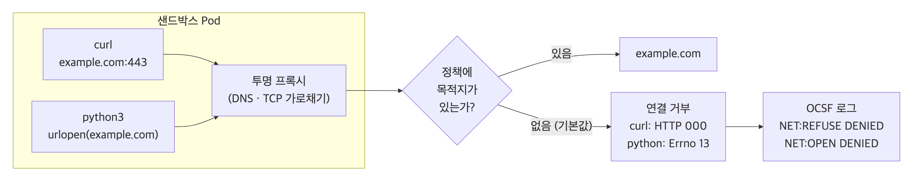

# 시나리오 21. 에이전트 샌드박스 기본 차단

> 상태: 검증 완료(2026-11-24, SNO, OpenShift 4.20.46, OpenShell 0.1.9). RHOAI 3.5에서 OpenShell은 Developer Preview이다.

## 기능 설명

- 분류: 에이전트 보안 > 실행 격리 (Developer Preview)
- OpenShell은 에이전트를 샌드박스 Pod에 격리하며, 네트워크 정책은 기본 차단(deny-by-default)이다.
- 샌드박스 안에는 프록시 환경 변수가 없다. supervisor가 DNS 조회와 TCP 연결을 투명하게 가로채, 정책에 없는 목적지는 연결 자체를 거부하고 OCSF 이벤트로 기록한다.
- 샌드박스 Pod는 `restricted-v2` SCC로 실행되며, 서비스 어카운트 토큰도 마운트되지 않는다.



## 사전 준비

- OpenShell 게이트웨이가 설치되어 있어야 한다. 설치 절차는 [시나리오 20. OpenShell 환경 설정](20-openshell-setup.md)을 따른다.
- 정책 파일: [policy-default-deny.yaml](../harness/openshell/policy-default-deny.yaml). 네트워크 규칙이 없으므로 모든 외부 연결이 거부된다.

```
openshell status
```

## 시연 절차

### 1) 기본 차단 정책으로 샌드박스 생성

```
openshell sandbox create --name sb-default \
  --from registry.access.redhat.com/ubi9/python-312:latest \
  --policy harness/openshell/policy-default-deny.yaml \
  --no-auto-providers --detach -- sleep infinity
openshell sandbox list
```

`--no-auto-providers`는 게이트웨이에 등록된 프로바이더가 자동으로 연결되는 것을 막는다.

### 2) 외부 연결 시도

```
openshell sandbox exec -n sb-default -- curl -sS -w 'HTTP %{http_code}\n' https://example.com
openshell sandbox exec -n sb-default -- python3 -c "import urllib.request;urllib.request.urlopen('https://example.com',timeout=5)"
```

### 3) 거부 이벤트 확인

시연자는 별도 터미널에서 `openshell term`을 열어 둔 뒤 2)를 다시 실행하고, `DENIED` 이벤트가 실시간으로 표시되는 것을 보여 준다.

```
openshell logs sb-default --since 5m | grep OCSF
```

## 결과 확인

시연자는 샌드박스가 일반 Pod로 실행되며 특권을 쓰지 않음을 OpenShift 리소스로 확인한다. 공유 워크스페이스 모드에서 샌드박스는 `openshell` 네임스페이스에 `default--<이름>`으로 생성된다.

시연 절차 2)와 3)의 출력은 다음과 같다.

```
$ openshell sandbox exec -n sb-default -- curl -sS -w 'HTTP %{http_code}\n' https://example.com
curl: (7) Couldn't connect to server
HTTP 000

$ openshell sandbox exec -n sb-default -- python3 -c "import urllib.request;urllib.request.urlopen('https://example.com',timeout=5)"
urllib.error.URLError: <urlopen error [Errno 13] Permission denied>

$ openshell logs sb-default --since 5m | grep OCSF
[sandbox] [OCSF ] [ocsf] NET:REFUSE [MED] DENIED example.com [reason:policy_dns_ineligible]
[sandbox] [OCSF ] [ocsf] NET:OPEN [MED] DENIED /usr/bin/curl(0) -> example.com:443 [reason:transparent_tcp_policy_denied]
[sandbox] [OCSF ] [ocsf] NET:REFUSE [MED] DENIED example.com [reason:policy_dns_ineligible]
[sandbox] [OCSF ] [ocsf] NET:OPEN [MED] DENIED /usr/bin/python3.12(0) -> example.com:443 [reason:transparent_tcp_policy_denied]
```

OpenShift 리소스 확인 결과는 다음과 같다.

```
$ oc get sandboxes.agents.x-k8s.io -n openshell
NAME                  AGE
default--sb-default   20s

$ oc get pods -n openshell
NAME                                                 READY   STATUS    RESTARTS   AGE
default--sb-default                                  1/1     Running   0          21s
openshell-0                                          1/1     Running   0          56m
os-supervisor-939538ad-81ee-4c80-a8fe-1cce1caade33   1/1     Running   0          21s

$ oc get pod default--sb-default -n openshell -o json | jq '{scc: .metadata.annotations["openshift.io/scc"], automount: .spec.automountServiceAccountToken, sc: [.spec.containers[] | {name, securityContext}]}'
{
  "scc": "restricted-v2",
  "automount": false,
  "sc": [
    {
      "name": "agent",
      "securityContext": {
        "allowPrivilegeEscalation": false,
        "capabilities": { "drop": [ "ALL" ] },
        "runAsGroup": 1001020000,
        "runAsNonRoot": true,
        "runAsUser": 1001020000
      }
    }
  ]
}
```

| 확인 항목 | 검증 결과 |
|------|------|
| curl `https://example.com` | `curl: (7) Couldn't connect to server`, HTTP 000 |
| python3 `urlopen` | `URLError [Errno 13] Permission denied` |
| 로그 | `NET:REFUSE [MED] DENIED example.com [reason:policy_dns_ineligible]`, `NET:OPEN [MED] DENIED /usr/bin/curl(0) -> example.com:443 [reason:transparent_tcp_policy_denied]` |
| SCC | `restricted-v2` |
| `agent` 컨테이너 | `capabilities.drop: [ALL]`, `allowPrivilegeEscalation: false`, `runAsNonRoot: true`, UID 1001020000(네임스페이스 범위) |
| 서비스 어카운트 토큰 | `automountServiceAccountToken: false` |

## 정리

```
openshell sandbox delete sb-default
```

## 운영 가이드

- 정책을 지정하지 않으면 내장 기본 정책(`landlock: best_effort`, `/proc`, `/var/log` 읽기 허용)이 적용된다. 운영자는 정책을 명시하고 `landlock.compatibility: hard_requirement`를 사용한다.
- 정책의 `filesystem_policy`에 `/dev/null`(쓰기)과 `/dev/urandom`, `/proc`(읽기)을 넣지 않으면 셸 초기화 스크립트와 일반 도구가 오동작한다(`/etc/profile: /dev/null: Permission denied`).
- 차단은 HTTP 403이 아니라 DNS 거부와 TCP 연결 실패로 나타난다. HTTP 403과 JSON 사유는 허용된 호스트에서 L7 규칙에 걸릴 때 반환된다(시나리오 22).
- 운영자는 `--level warn`으로 로그를 거르지 않는다. 정책 이벤트가 숨겨진다.
