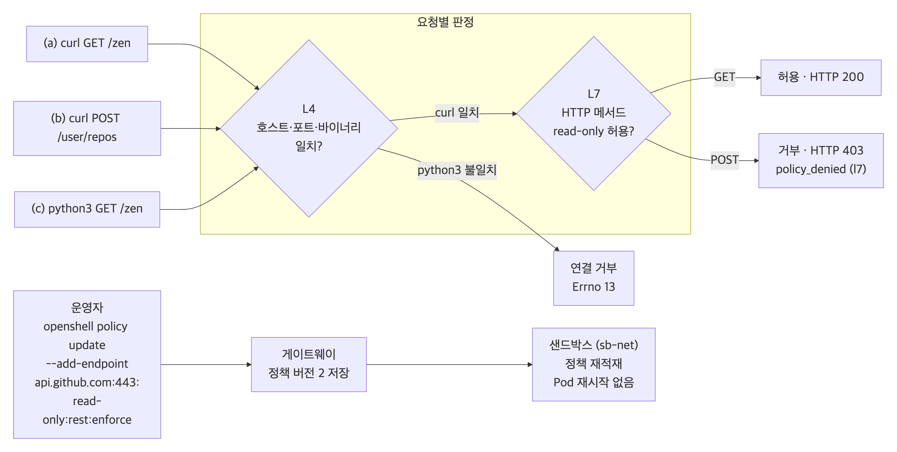

# 시나리오 22. 네트워크 정책 승인과 무중단 반영

> 상태: 검증 완료(2026-11-24, SNO, OpenShift 4.20.46, OpenShell 0.1.9). RHOAI 3.5에서 OpenShell은 Developer Preview이다.

## 기능 설명

- 분류: 에이전트 보안 > 네트워크 통제 (Developer Preview)
- 운영자는 에이전트가 접근할 목적지를 호스트, 포트, 프로토콜, 접근 수준, 실행 바이너리 단위로 허용한다.
- 접근 수준 `read-only`는 L7(HTTP 메서드) 수준에서 GET 등 읽기 요청만 통과시킨다.
- 네트워크 정책은 실행 중인 샌드박스에 즉시 반영된다. 에이전트 프로세스와 Pod는 재시작되지 않는다.



| 판정 단계 | 기준 | 불일치 시 |
|------|------|------|
| L4 | 목적지 호스트·포트와 연결을 연 실행 파일(`binaries`) | 연결 거부 (DNS·TCP) |
| L7 | HTTP 메서드·경로 (`access: read-only`는 GET·HEAD·OPTIONS) | HTTP 403과 거부 사유 JSON |

## 사전 준비

- OpenShell 게이트웨이가 설치되어 있어야 한다. 설치 절차는 [시나리오 20. OpenShell 환경 설정](20-openshell-setup.md)을 따른다.

```
openshell status
openshell sandbox create --name sb-net \
  --from registry.access.redhat.com/ubi9/python-312:latest \
  --policy harness/openshell/policy-default-deny.yaml \
  --no-auto-providers --detach -- sleep infinity
```

## 시연 절차

### 1) 승인 전: 차단 확인

```
openshell sandbox exec -n sb-net -- curl -sS -o /dev/null -w 'HTTP %{http_code}\n' https://api.github.com/zen
oc get pod default--sb-net -n openshell -o jsonpath='{.status.containerStatuses[0].restartCount} {.status.startTime}{"\n"}'
```

### 2) 정책 승인: curl에 GitHub API 읽기 전용 허용

```
openshell policy update sb-net --rule-name github_readonly \
  --binary /usr/bin/curl \
  --add-endpoint api.github.com:443:read-only:rest:enforce --wait
```

엔드포인트 형식은 `호스트:포트:접근수준:프로토콜:적용모드`이다.

### 3) 승인 후: 허용 범위만 통과하는지 확인

```
# (a) curl + GET → 허용
openshell sandbox exec -n sb-net -- curl -sS -w '\nHTTP %{http_code}\n' https://api.github.com/zen
# (b) curl + POST → read-only이므로 L7에서 거부
openshell sandbox exec -n sb-net -- curl -sS -X POST -w '\nHTTP %{http_code}\n' https://api.github.com/user/repos -d '{}'
# (c) python3 + GET → 승인되지 않은 바이너리이므로 거부
openshell sandbox exec -n sb-net -- python3 -c "import urllib.request;print(urllib.request.urlopen('https://api.github.com/zen',timeout=10).read())"
```

## 결과 확인

시연 절차의 출력은 다음과 같다.

```
# 1) 승인 전
$ openshell sandbox exec -n sb-net -- curl -sS -o /dev/null -w 'HTTP %{http_code}\n' https://api.github.com/zen
curl: (7) Couldn't connect to server
HTTP 000
$ oc get pod default--sb-net -n openshell -o jsonpath='{.status.containerStatuses[0].restartCount} {.status.startTime}{"\n"}'
0 2026-11-24T02:16:00Z

# 2) 정책 승인
$ openshell policy update sb-net --rule-name github_readonly --binary /usr/bin/curl \
    --add-endpoint api.github.com:443:read-only:rest:enforce --wait
✓ Policy version 2 submitted (hash: 31b4e78de941)
✓ Policy version 2 loaded (active version: 2)

# 3-a) curl GET
Non-blocking is better than blocking.
HTTP 200

# 3-b) curl POST
{"error":"policy_denied","policy":"github_readonly","rule":"POST /user/repos",
 "detail":"POST /user/repos not permitted by policy","layer":"l7","protocol":"rest",
 "method":"POST","path":"/user/repos","host":"api.github.com","port":443,
 "binary":"/usr/bin/curl","rule_missing":{"type":"rest_allow","layer":"l7",...},"next_steps":[]}
HTTP 403

# 3-c) python3 GET
urllib.error.URLError: <urlopen error [Errno 13] Permission denied>
```

정책 이력, 로그, Pod 상태는 다음과 같다.

```
$ openshell policy list sb-net
VERSION  HASH           STATUS       CREATED
2        31b4e78de941   Loaded       1795486581878
1        1caaf20d13ff   Superseded   1795486556941

$ openshell logs sb-net --since 10m | grep OCSF | grep -E 'NET:OPEN|HTTP:|CONFIG:LOADED'
CONFIG:LOADED [INFO] Acknowledged initial policy revision as loaded [version:1]
NET:OPEN [MED] DENIED /usr/bin/curl(0) -> api.github.com:443 [reason:transparent_tcp_policy_denied]
CONFIG:LOADED [INFO] Policy reloaded successfully [policy_hash:31b4e78de941...]
NET:OPEN [INFO] ALLOWED /usr/bin/curl(0) -> api.github.com:443 [policy:github_readonly engine:opa]
HTTP:GET [INFO] ALLOWED GET https://api.github.com/zen [policy:github_readonly engine:l7]
NET:OPEN [INFO] ALLOWED /usr/bin/curl(0) -> api.github.com:443 [policy:github_readonly engine:opa]
HTTP:POST [MED] DENIED POST https://api.github.com/user/repos [policy:github_readonly engine:l7] [reason:L7_REQUEST deny ...]
NET:OPEN [MED] DENIED /usr/bin/python3.12(0) -> api.github.com:443 [reason:transparent_tcp_policy_denied]

$ oc get pod default--sb-net -n openshell -o jsonpath='{.status.containerStatuses[0].restartCount} {.status.startTime}{"\n"}'
0 2026-11-24T02:16:00Z
```

로그 줄 앞의 `[타임스탬프] [sandbox] [OCSF ] [ocsf]`는 생략했다.

| 요청 | 검증 결과 |
|------|------|
| 승인 전 curl GET | HTTP 000 (연결 거부) |
| 정책 반영 | `Policy version 2 loaded`, 버전 1은 `Superseded` |
| 승인 후 curl GET | HTTP 200, `NET:OPEN ALLOWED ... [policy:github_readonly engine:opa]` |
| 승인 후 curl POST | HTTP 403, `HTTP:POST [MED] DENIED ... [engine:l7]` |
| 승인 후 python3 GET | `[Errno 13] Permission denied`, `DENIED /usr/bin/python3.12(0) -> api.github.com:443` |
| Pod `restartCount`, `startTime` | 승인 전후 동일 (0, 같은 시각) |

## 정리

```
openshell sandbox delete sb-net
```

## 운영 가이드

- 운영자는 정책 YAML을 Git으로 관리하고 `openshell policy set <sandbox> --policy <file> --wait`로 반영한다. `--dry-run`으로 변경 내용을 미리 확인한다.
- 새 규칙은 `enforcement: audit`으로 먼저 배포해 트래픽을 관찰한 뒤 `enforce`로 전환한다. 생략하면 기본값이 `audit`이므로 차단 목적의 규칙에는 `enforce`를 반드시 명시한다.
- 바이너리 규칙은 실제 실행 파일 경로로 비교한다. UBI9 Python 이미지의 `python3`는 `/usr/bin/python3.12`로 기록되므로, 규칙에는 실제 경로나 `/usr/bin/python3*`를 사용한다.
- 파일시스템·프로세스 정책은 실행 중에 바꿔도 적용되지 않는다(시나리오 24).
